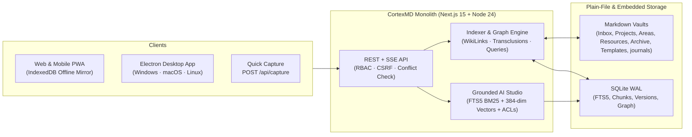

<div align="center">

# CortexMD

**A self-hosted, Markdown-first, AI-native personal knowledge management platform.**

Plain `.md` files on disk. Zero mandatory API keys. Embedded SQLite FTS5 + 384-dim semantic search.  
Run it on your homelab with Docker or as a 100% offline standalone desktop app.

[](https://github.com/LukaG712/CortexMD/actions/workflows/release.yml)


[Quick Start](#-quick-start) •
[Features](#-core-capabilities) •
[Architecture](#-architecture) •
[AI Studio](#-grounded-ai-studio) •
[Desktop App](#option-1--standalone-desktop-app-windows--macos--linux) •
[Documentation](#-documentation)

</div>

---

## Why CortexMD?

Most knowledge tools force a trade-off between **local ownership**, **multi-device sync**, and **verifiable AI**. CortexMD combines all three in a single lightweight Next.js + `node:sqlite` monolith:

| Capability | Traditional Local-First | Cloud SaaS PKM | **CortexMD** |
| :--- | :--- | :--- | :--- |
| **Source of Truth** | Plain `.md` (sync conflicts common) | Proprietary database / export | **Plain `.md` + `/assets/` on disk** |
| **Multi-Device Sync** | Third-party sync daemons | Vendor cloud | **Real-time SSE + 3-way conflict resolver** |
| **AI & RAG** | Paid plugins & external API keys | Cloud-only, opaque context | **Zero-key `local-hybrid` built-in + optional LLMs** |
| **AI Safety** | Unrestricted prompt access | Vendor-managed | **Per-folder ACLs (`allow`/`deny`) + diff-gated edits** |
| **Deployment** | Desktop only | Hosted only | **Docker / Proxmox LXC + Offline Desktop + PWA** |

---

## Architecture



---

## Core Capabilities

### Markdown-First Knowledge Base
- **Standard Vault Structure:** Every workspace initializes clean PARA-ready folders (`Inbox/`, `Projects/`, `Areas/`, `Resources/`, `Archive/`, `Templates/`, `journals/`, `assets/`) with nested subfolder creation directly from the sidebar.
- **Rich Linking & Transclusion:** `[[WikiLinks]]`, automatic backlinks, one-click unlinked mention conversion, automatic backlink refactoring on rename, and full/section/block transclusion (`![[Note]]`, `![[Note#Heading]]`, `![[Note#^block-id]]`).
- **Interactive Knowledge Graph & Canvas:** 1-hop local graph view, shortest-path finder, semantic ghost links, community clusters, and **JSON Canvas 1.0** (`.canvas`) spatial boards.

### Structured Views & Active Recall
- **YAML Properties & Live Queries:** Interactive frontmatter properties grid and embedded `cortex-query` live tables/lists.
- **Tasks, Calendar & Flashcards:** Drag-and-drop Kanban boards (`status` / `priority`), activity heatmap with daily journals, and **SM-2 spaced repetition** flashcards (`Q:`/`A:`, `::`, `#card`).

### Craft, Sync & Homelab Ops
- **Themes & Focus Modes:** Switch between **Obsidian Dark** and warm alabaster **Paper**, toggle **Pentagram `Aa` Editorial Serif** (`68ch` measure), or enter **Zen Focus** mode.
- **Home Dashboard & Faceted `Ctrl+K`:** Vault KPIs, Quick Capture bar, Daily Streak tracker, 5-step onboarding quest, and faceted command palette (`mode`, `type`, `folder`, `tag`) with live note preview.
- **Conflict-Safe Multi-Device Sync:** `baseSha256` optimistic concurrency with side-by-side 3-way hunk resolution, version snapshots, per-vault Git snapshots, and offline-capable **PWA**.
- **Multi-User RBAC:** `scrypt` password hashing, `HttpOnly` sessions, CSRF protection, and per-workspace `admin` / `editor` / `viewer` roles.

<details>
<summary><strong>Markdown & Keyboard Cheatsheet</strong> (click to expand)</summary>

#### Keyboard Shortcuts
| Shortcut | Action |
| :--- | :--- |
| `Ctrl+K` / `Cmd+K` | Open faceted Command Palette (Hybrid FTS5 + semantic search) |
| `Ctrl+I` / `Cmd+I` | Inline AI Rewrite with side-by-side diff preview |
| `Ctrl+O` | *(Desktop)* Open Vault directory in OS File Explorer / Finder |

#### Live Embedded Queries (`cortex-query`)
````markdown
```cortex-query
tag: #homelab
status: active
sort: updated desc
view: table
limit: 10
```
````

#### Flashcards (SM-2 Spaced Repetition)
```markdown
Q: What isolates Proxmox LXC backups?
A: Separate HDD dataset and incremental snapshots.

SM-2 :: SuperMemo-2 spaced repetition algorithm.

### Default Hash Algorithm #card
scryptSync with per-user 16-byte random salt.
```

#### Diagrams & Math
- Diagrams via standard ` ```mermaid ` code fences
- LaTeX math via inline `$E = mc^2$` or block `$$ ... $$`

</details>

---

## Grounded AI Studio

CortexMD works **out of the box** with zero external API keys using its built-in **`local-hybrid`** engine (SQLite FTS5 BM25 + sublinear-TF 384-dimension semantic embeddings).

- **Verifiable Citations:** Streaming SSE chat with `#Lstart-Lend` line citations and hover citation previews.
- **Synthesis Tools:** Contradiction scan, Study Guides, FAQs, Two-Host Audio Briefings (Web Speech API), and URL/HTML web clipper (`Sources/*.md`).
- **Approval-Gated Agent Edits:** Inline `Ctrl+I` rewrites and Vault Gardener proposals render unified diffs before touching disk, enforced by per-folder AI ACLs (`allow` / `deny`).

| Provider | Mode | Configuration |
| :--- | :--- | :--- |
| **`local-hybrid`** *(default)* | Built-in offline | Zero config — FTS5 + local 384-dim vectors |
| `ollama` | Self-hosted LLM | `OLLAMA_BASE_URL`, `OLLAMA_MODEL` |
| `gemini-cli` | Local CLI (OAuth 2.0) | Google Gemini CLI |
| `github-copilot` | OAuth pass-through | `COPILOT_GITHUB_TOKEN` |
| `jetbrains-junie` | Headless CLI / BYOK | `JUNIE_API_KEY` |
| `gemini-api` | Cloud API | `GEMINI_API_KEY` |

---

## Quick Start

### Option 1 — Standalone Desktop App (Windows / macOS / Linux)

Run CortexMD 100% offline with zero Docker, zero external server, automatic single-user login, and native vaults stored in `Documents/CortexMD/vaults/`.

- **Pre-built Installers:** Download `.exe` / `.zip` (Windows), `.dmg` / `.zip` (macOS Apple Silicon & Intel), or `.AppImage` / `.deb` / `.tar.gz` (Linux) from **[GitHub Releases](https://github.com/LukaG712/CortexMD/releases)**.
- **Run or build locally from source:**
  ```bash
  git clone https://github.com/LukaG712/CortexMD.git
  cd CortexMD
  npm install

  # Launch desktop app locally
  npm run desktop

  # Or build installers for your OS
  npm run dist:win     # Windows (.exe, .zip)
  npm run dist:mac     # macOS (.dmg, .zip x64 + arm64)
  npm run dist:linux   # Linux (.AppImage, .deb, .tar.gz)
  ```

---

### Option 2 — Docker Compose (Homelab / Proxmox LXC)

1. **Clone and configure environment variables:**
   ```bash
   git clone https://github.com/LukaG712/CortexMD.git
   cd CortexMD
   cp .env.example .env
   ```
   Replace `ADMIN_PASSWORD` and `APP_SECRET` (32+ random characters) in `.env` before exposing over your LAN or VPN.

2. **Start the container:**
   ```bash
   docker compose up -d --build
   ```

3. **Open CortexMD:**  
   Visit `http://localhost:3000` (default `.env.example` credentials: `admin` / `cortex-admin-change-me`).

> Vaults and the SQLite index persist outside the container at `${CORTEX_HOST_DATA_PATH:-./data}` (mapped to `/data`), with backups at `${CORTEX_HOST_BACKUP_PATH:-./backups}`.

---

### Option 3 — Local Development (Node.js 24+)

Requires **Node.js 22.5+ / 24+** (uses built-in `node:sqlite`) and `npm`.

```bash
git clone https://github.com/LukaG712/CortexMD.git
cd CortexMD
cp .env.example .env
npm install
npm run dev
```

<details>
<summary><strong>Development, Verification & Mobile PWA</strong></summary>

```bash
npm run dev    # Start Next.js development server
npm run lint   # Run TypeScript compiler check (tsc --noEmit)
npm test       # Run Vitest end-to-end test suite (20 tests in tests/platform.test.ts)
npm run build  # Build production Next.js bundle
npm start      # Serve production build
```

**Mobile PWA:** Open your CortexMD URL in Chrome/Firefox (Android) or Safari (iOS) and tap **Install App / Add to Home Screen** for full-screen offline access via IndexedDB and native Web Share Target support.

</details>

---

## Quick Capture Webhook & Configuration

Append notes from mobile shortcuts, Home Assistant, or cron jobs by setting `CORTEX_CAPTURE_TOKEN` in `.env`:

```bash
curl -X POST http://localhost:3000/api/capture \
  -H "Authorization: Bearer YOUR_CAPTURE_TOKEN" \
  -H "Content-Type: application/json" \
  -d '{
    "workspaceSlug": "personal",
    "title": "Homelab Alert",
    "text": "Proxmox nightly backup completed.",
    "url": "https://pve.local:8006",
    "tags": ["homelab", "backup"],
    "target": "inbox"
  }'
```

Set `"target": "daily"` to append directly to `journals/YYYY-MM-DD.md` instead of `Inbox/Quick Captures.md`.

<details>
<summary><strong>Environment Variables (<code>.env</code>)</strong></summary>

| Variable | Description | Default / Example |
| :--- | :--- | :--- |
| `CORTEX_DATA_DIR` | Directory holding vaults & SQLite index | `./data` (`/data` in Docker) |
| `ADMIN_USERNAME` | Initial administrator username | `admin` |
| `ADMIN_PASSWORD` | Initial administrator password | `cortex-admin-change-me` |
| `APP_SECRET` | Session signing & encrypted provider key secret (32+ chars) | *(set in `.env`)* |
| `CORTEX_CAPTURE_TOKEN` | Bearer token for `POST /api/capture` | *(empty = disabled)* |
| `GEMINI_API_KEY` | Optional Gemini API key | *(optional)* |
| `COPILOT_GITHUB_TOKEN` | Optional GitHub Copilot token | *(optional)* |
| `JUNIE_API_KEY` | Optional JetBrains Junie API key | *(optional)* |
| `OLLAMA_BASE_URL` | Ollama server endpoint | `http://127.0.0.1:11434` |
| `OLLAMA_MODEL` | Default Ollama model name | `llama3.2` |
| `TRUSTED_PROXY_AUTH_HEADER` | Reverse-proxy OAuth username header (Authentik / Authelia) | *(empty = disabled)* |

</details>

---

## Repository Structure

```text
CortexMD/
├── .github/workflows/   # Automated Windows, macOS & Linux release builds
├── docs/                # Architecture, Proxmox deployment, research & plans
├── electron/            # Electron desktop shell & standalone server wrapper
├── scripts/             # Standalone packaging helpers
├── src/
│   ├── app/             # Next.js App Router pages & REST/SSE API routes
│   ├── components/      # Editor, Knowledge Graph, Canvas, Dashboard & AI UI
│   └── lib/             # SQLite FTS5 indexer, RAG engine, ACLs & vault storage
└── tests/               # End-to-end Vitest platform verification suite
```

---

## Documentation

- [Architecture Overview](docs/ARCHITECTURE.md)
- [Proxmox & Docker Deployment Guide](docs/PROXMOX_DEPLOYMENT.md)
- [Research & Ecosystem Comparison](docs/RESEARCH.md)
- [Implementation Plan](docs/IMPLEMENTATION_PLAN.md)
- [Implementation Status](docs/IMPLEMENTATION_STATUS.md)
