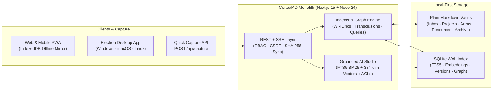

<div align="center">

<h1>CortexMD</h1>

<p>
  <strong>Self-hosted, Markdown-first, AI-native personal knowledge platform.</strong>
</p>

[](https://github.com/LukaG712/CortexMD/actions/workflows/release.yml)
[](https://github.com/LukaG712/CortexMD/releases)


<p>
  CortexMD unifies <strong>plain Markdown vaults</strong>, <strong>structured Notion-style views</strong>, and a <strong>zero-key local AI studio</strong> in a single Next.js + <code>node:sqlite</code> monolith — deployable on your homelab or as an offline desktop app.
</p>

<p>
  <a href="#-quick-start"><strong>Quick Start</strong></a> &nbsp;·&nbsp;
  <a href="#-platform-pillars"><strong>Features</strong></a> &nbsp;·&nbsp;
  <a href="#-architecture"><strong>Architecture</strong></a> &nbsp;·&nbsp;
  <a href="#-grounded-ai-studio"><strong>AI Studio</strong></a> &nbsp;·&nbsp;
  <a href="#-security--privacy"><strong>Security</strong></a> &nbsp;·&nbsp;
  <a href="#-documentation"><strong>Docs</strong></a>
</p>

</div>

---

> [!TIP]
> **Zero API Keys Required:** CortexMD ships with a built-in **`local-hybrid`** RAG engine (SQLite FTS5 BM25 + 384-dimension semantic embeddings). Your notes stay on your disk and never leave your machine unless you explicitly enable an external LLM provider.

---

## Platform Pillars

<table>
  <tr>
    <td width="50%" valign="top">
      <h3>🗂️ Plain-Text Source of Truth</h3>
      <ul>
        <li><strong>PARA-Ready Vaults:</strong> Auto-initializes <code>Inbox/</code>, <code>Projects/</code>, <code>Areas/</code>, <code>Resources/</code>, <code>Archive/</code>, <code>Templates/</code>, <code>journals/</code>, and <code>assets/</code>.</li>
        <li><strong>Nested Explorer:</strong> Create folders and deeply nested subfolders directly from the sidebar.</li>
        <li><strong>Graph &amp; Transclusion:</strong> <code>[[WikiLinks]]</code>, backlink refactoring on rename, unlinked mention discovery, <code>![[Note#Heading]]</code> transclusions, and <strong>JSON Canvas 1.0</strong> boards.</li>
      </ul>
    </td>
    <td width="50%" valign="top">
      <h3>🧠 Grounded AI Studio</h3>
      <ul>
        <li><strong>Verifiable Citations:</strong> Streaming SSE answers with exact <code>#Lstart-Lend</code> line citations and hover previews.</li>
        <li><strong>Synthesis &amp; Audio:</strong> One-click Study Guides, FAQs, Contradiction Scans, Two-Host Audio Briefings, and URL Web Clipper.</li>
        <li><strong>Diff-Gated Agents:</strong> Inline <code>Ctrl+I</code> rewrites and Vault Gardener edits render unified diffs for human approval before touching disk.</li>
      </ul>
    </td>
  </tr>
  <tr>
    <td width="50%" valign="top">
      <h3>⚡ Structured Views &amp; Active Recall</h3>
      <ul>
        <li><strong>Live Queries:</strong> Embedded <code>cortex-query</code> code blocks render live filtered tables and lists across your vault.</li>
        <li><strong>Kanban &amp; Calendar:</strong> Drag-and-drop task boards (<code>status</code> / <code>priority</code>) and activity heatmaps linked to daily notes.</li>
        <li><strong>SM-2 Flashcards:</strong> Write <code>Q:</code>/<code>A:</code>, <code>::</code>, or <code>#card</code> inline and review with spaced repetition.</li>
      </ul>
    </td>
    <td width="50%" valign="top">
      <h3>🔄 Conflict-Safe Sync &amp; Craft</h3>
      <ul>
        <li><strong>Optimistic Concurrency:</strong> <code>baseSha256</code> verification catches concurrent edits and opens a 3-way hunk-by-hunk conflict resolver.</li>
        <li><strong>Offline PWA + Git:</strong> Real-time SSE sync, IndexedDB offline mirror, version snapshots, and per-vault Git commits.</li>
        <li><strong>Editorial Craft:</strong> Switch between <strong>Obsidian Dark</strong> and <strong>Paper</strong>, toggle <strong>Editorial Serif</strong>, or enter <strong>Zen Focus</strong> mode.</li>
      </ul>
    </td>
  </tr>
</table>

---

## Why CortexMD?

| Capability | Local-First Sync Tools | Cloud SaaS PKM | **CortexMD** |
| :--- | :--- | :--- | :--- |
| **Data Ownership** | Plain `.md` on disk | Proprietary cloud DB | **Plain `.md` + `/assets/` on your disk** |
| **Multi-Device Sync** | Fragile 3rd-party file sync | Vendor cloud | **Real-time SSE + 3-way conflict resolver** |
| **AI & RAG** | Paid plugins & API keys | Cloud-only, opaque | **Zero-key `local-hybrid` built-in + BYO LLM** |
| **AI Access Control** | Unrestricted file reads | Vendor-managed | **Per-folder ACLs (`allow`/`deny`) + diff approval** |
| **Deployment** | Desktop only | Hosted only | **Offline Desktop + Docker / Proxmox + PWA** |

---

## Architecture



---

## Grounded AI Studio

Choose **zero-key offline intelligence** by default, or connect your preferred local/cloud provider in `.env` or **Settings**:

| Provider | Execution | Requirements |
| :--- | :--- | :--- |
| **`local-hybrid`** *(Default)* | Embedded FTS5 + 384-dim vectors | **None** — 100% offline, zero API keys |
| **`ollama`** | Self-hosted local models | `OLLAMA_BASE_URL`, `OLLAMA_MODEL` |
| **`gemini-cli`** | Local CLI (Google OAuth 2.0) | Local Gemini CLI login |
| **`github-copilot`** | GitHub OAuth pass-through | `COPILOT_GITHUB_TOKEN` |
| **`jetbrains-junie`** | Headless CLI / BYOK | `JUNIE_API_KEY` |
| **`gemini-api`** | Google Gemini Cloud API | `GEMINI_API_KEY` |

---

## Security & Privacy

> [!IMPORTANT]
> CortexMD is engineered with defense-in-depth for both self-hosted homelabs and agentic AI workflows.

- **Pre-Retrieval Folder ACLs:** Restricted directories (such as `Private/`) are filtered *before* chunks ever enter RAG retrieval or external LLM prompts.
- **Prompt Injection Isolation:** Indexed note content is wrapped in `<untrusted_note_data>` boundaries before being forwarded to any external model.
- **Human-in-the-Loop Mutations:** AI agents can only propose unified diffs — no file on disk is ever modified without explicit user approval.
- **Hardened Auth & RBAC:** `scrypt` per-user salted password hashing, `HttpOnly` sessions, CSRF tokens, optional reverse-proxy SSO (`TRUSTED_PROXY_AUTH_HEADER`), and workspace `admin` / `editor` / `viewer` roles.

---

## Quick Start

### Option 1 — Standalone Desktop App (Windows · macOS · Linux)

Run CortexMD 100% offline with zero Docker, automatic single-user login, and native vaults stored in `Documents/CortexMD/vaults/`.

- **Pre-built Installers:** Download `.exe` / `.zip` (Windows), `.dmg` / `.zip` (macOS Apple Silicon & Intel), or `.AppImage` / `.deb` / `.tar.gz` (Linux) from **[GitHub Releases](https://github.com/LukaG712/CortexMD/releases)**.
- **Run or package from source:**
  ```bash
  git clone https://github.com/LukaG712/CortexMD.git
  cd CortexMD
  npm install

  npm run desktop      # Launch desktop app locally
  npm run dist:win     # Build Windows (.exe, .zip)
  npm run dist:mac     # Build macOS (.dmg, .zip x64 + arm64)
  npm run dist:linux   # Build Linux (.AppImage, .deb, .tar.gz)
  ```

---

### Option 2 — Docker Compose (Homelab / Proxmox LXC)

```bash
git clone https://github.com/LukaG712/CortexMD.git
cd CortexMD
cp .env.example .env
# Edit .env to set strong ADMIN_PASSWORD and APP_SECRET (32+ chars)
docker compose -f docker/docker-compose.yml up -d --build
```

Open **`http://localhost:3000`** (default `.env.example` credentials: `admin` / `cortex-admin-change-me`).  
Persistent vaults and SQLite data live outside the container at `./data` and `./backups`.

---

### Option 3 — Local Development (Node.js 24+)

```bash
git clone https://github.com/LukaG712/CortexMD.git
cd CortexMD
cp .env.example .env
npm install
npm run dev
```

<details>
<summary><strong>Verification Scripts &amp; Mobile PWA Setup</strong></summary>

```bash
npm run dev    # Start Next.js development server
npm run lint   # Run TypeScript compiler check (tsc --noEmit)
npm test       # Run Vitest end-to-end platform suite (20 tests)
npm run build  # Build production Next.js bundle
npm start      # Serve production build
```

**Mobile PWA:** Open your CortexMD URL in Chrome/Firefox (Android) or Safari (iOS) and tap **Install App / Add to Home Screen** for full-screen offline access via IndexedDB and native Web Share Target support.

</details>

---

## Reference & Configuration

<details>
<summary><strong>Markdown, Shortcuts, Live Queries &amp; Flashcard Syntax</strong></summary>

| Shortcut | Action |
| :--- | :--- |
| `Ctrl+K` / `Cmd+K` | Faceted Command Palette (Hybrid FTS5 + semantic search) |
| `Ctrl+I` / `Cmd+I` | Inline AI Rewrite with side-by-side diff preview |
| `Ctrl+O` | *(Desktop)* Open Vault directory in OS File Explorer / Finder |

**Live Embedded Queries (`cortex-query`):**
````markdown
```cortex-query
tag: #homelab
status: active
sort: updated desc
view: table
limit: 10
```
````

**SM-2 Flashcards:**
```markdown
Q: What isolates Proxmox LXC backups?
A: Separate HDD dataset and incremental snapshots.

SM-2 :: SuperMemo-2 spaced repetition algorithm.

### Default Hash Algorithm #card
scryptSync with per-user 16-byte random salt.
```

</details>

<details>
<summary><strong>Quick Capture Webhook (<code>POST /api/capture</code>)</strong></summary>

Set `CORTEX_CAPTURE_TOKEN` in `.env` to append notes from mobile shortcuts, Home Assistant, or cron jobs:

```bash
curl -X POST http://localhost:3000/api/capture \
  -H "Authorization: Bearer YOUR_CAPTURE_TOKEN" \
  -H "Content-Type: application/json" \
  -d '{
    "workspaceSlug": "personal",
    "title": "Homelab Alert",
    "text": "Proxmox nightly backup completed.",
    "url": "https://pve.local:8006",
    "tags": ["homelab", "backup"],
    "target": "inbox"
  }'
```

Set `"target": "daily"` to append to `journals/YYYY-MM-DD.md` instead of `Inbox/Quick Captures.md`.

</details>

<details>
<summary><strong>Environment Variables (<code>.env</code>)</strong></summary>

| Variable | Description | Default / Example |
| :--- | :--- | :--- |
| `CORTEX_DATA_DIR` | Directory holding vaults & SQLite index | `./data` (`/data` in Docker) |
| `ADMIN_USERNAME` | Initial administrator username | `admin` |
| `ADMIN_PASSWORD` | Initial administrator password | `cortex-admin-change-me` |
| `APP_SECRET` | Session signing & encrypted key secret (32+ chars) | *(set in `.env`)* |
| `CORTEX_CAPTURE_TOKEN` | Bearer token for `POST /api/capture` | *(empty = disabled)* |
| `GEMINI_API_KEY` | Optional Gemini API key | *(optional)* |
| `COPILOT_GITHUB_TOKEN` | Optional GitHub Copilot token | *(optional)* |
| `JUNIE_API_KEY` | Optional JetBrains Junie API key | *(optional)* |
| `OLLAMA_BASE_URL` | Ollama server endpoint | `http://127.0.0.1:11434` |
| `OLLAMA_MODEL` | Default Ollama model name | `llama3.2` |
| `TRUSTED_PROXY_AUTH_HEADER` | Reverse-proxy OAuth username header | *(empty = disabled)* |

</details>

---

## Repository Structure

```text
CortexMD/
├── .github/workflows/   # Automated Windows, macOS & Linux release builds
├── docker/              # Dockerfile & Docker Compose deployment config
├── docs/                # Architecture, Proxmox deployment, research & plans
├── electron/            # Electron desktop shell & electron-builder config
├── scripts/             # Standalone packaging helpers
├── src/
│   ├── app/             # Next.js App Router pages & REST/SSE API routes
│   ├── components/      # Editor, Knowledge Graph, Canvas, Dashboard & AI UI
│   └── lib/             # SQLite FTS5 indexer, RAG engine, ACLs & vault storage
└── tests/               # Vitest config & end-to-end platform test suite
```

## Documentation

- [Architecture Overview](docs/ARCHITECTURE.md)
- [Proxmox & Docker Deployment Guide](docs/PROXMOX_DEPLOYMENT.md)
- [Research & Ecosystem Comparison](docs/RESEARCH.md)
- [Implementation Plan](docs/IMPLEMENTATION_PLAN.md)
- [Implementation Status](docs/IMPLEMENTATION_STATUS.md)

---

<div align="center">
  <sub>Built for local-first thinkers. Plain Markdown forever.</sub>
</div>
